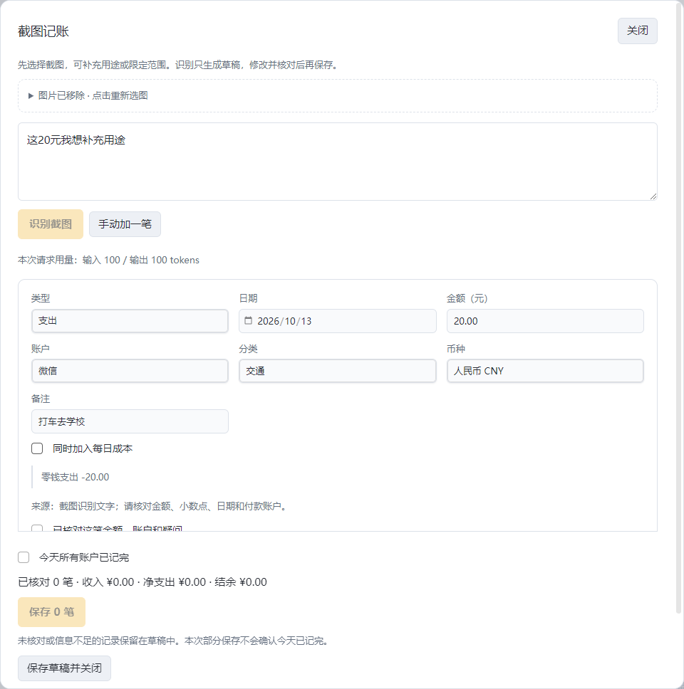

# LifeLedger

**在 Obsidian 里记录收支、管理账户余额和查看生活成本。作者：Silas。**

LifeLedger 是一个电脑端 Obsidian 记账插件。你可以手动填一笔账，也可以输入一段话或几张账单截图，让自己配置的 AI API 整理成草稿；检查、修改后再保存。账户、账目和草稿保存在自己的 Obsidian 仓库（Vault）里。

它还会把你愿意纳入计算的资金，按已记录的日均生活成本换算成可支撑天数。界面中的“财富自由指南灯”就是这个数字的可视化，每一格代表一天。

**当前版本：0.1.6 预览版。** 需要电脑端 Obsidian 1.11.4 或以上，支持浅色和深色，手机端暂不支持。桌面检查使用 Windows 上的 Obsidian 1.14.4；真实 AI 识别和长期日常使用仍需持续验证。

[下载 0.1.6 安装包](https://github.com/wangkefan0309-ui/LifeLedger-Next/releases/download/v0.1.6/LifeLedger-0.1.6.zip) · [发布页](https://github.com/wangkefan0309-ui/LifeLedger-Next/releases/tag/v0.1.6) · [版本更新记录](CHANGELOG.md) · [反馈问题](https://github.com/wangkefan0309-ui/LifeLedger-Next/issues)


<details>
<summary>查看深色首页</summary>


</details>

## 能做什么

| 功能 | 实际用法 |
| --- | --- |
| 三种录入方式 | 手动记账、文字批量整理、账单截图识别；识别后都能逐笔修改 |
| 多账户 | 管理微信、支付宝、银行卡、饭卡等账户，设置期初余额、默认付款账户和别名 |
| 多币种 | 人民币、美元、港币各记本币余额，显示约合金额，记录实际换汇 |
| 日历账本 | 按月份和日期查账，按账户／分类筛选，更正、删除和撤销 |
| 收支分析 | 查看已记录的收支、分类及趋势，点击图表查对应账目 |
| 每日成本 | 把电脑、会员等购买成本按使用期分摊展示，购买款只扣一次 |
| 可支撑天数 | 用选定的可用资金除以日均生活成本，显示人生亮格和变化动画 |
| 备份恢复 | 导出账户、交易和草稿的 JSON 备份，恢复到空目录 |

手动记账无需 API，也可离线。文字整理和截图识别需要自己的 API；Typeless 仅是可选的外部语音转文字工具，插件本身不录音。无需另外运行 Python 或服务器。

## 安装和更新

### 第一次安装

1. 从上方下载 **LifeLedger-0.1.6.zip**，解压。
2. 将里面的 **lifeledger-next** 文件夹放入自己的 Vault：

   ```text
   你的 Vault/.obsidian/plugins/lifeledger-next/
     main.js
     manifest.json
     styles.css
   ```

3. 打开 Obsidian“设置 → 第三方插件”，允许第三方插件，刷新已安装列表并启用 LifeLedger。
4. 点击左侧钱包图标，或在命令面板执行“LifeLedger：打开首页”。

如果找不到插件，检查是否多套了一层文件夹：三个运行文件应直接位于 `lifeledger-next/` 内。GitHub 的“Code → Download ZIP”下载的是源码，源码需要先构建；直接使用请下载 Release 中的安装包。目前还未进入 Obsidian 社区插件目录。

### 更新本仓库的已有版本

先在 LifeLedger 设置导出备份，然后关闭插件，覆盖 `main.js`、`manifest.json`、`styles.css`，保留 `data.json` 和 Vault 中的账本，再重新启用。插件目录名称保持 `lifeledger-next`。

### 从旧 Obsidian-LifeLedger 项目过来

本仓库是重新开发的版本，旧 [Obsidian-LifeLedger](https://github.com/wangkefan0309-ui/Obsidian-LifeLedger) 已停止维护并归档。旧插件的数据格式和本版本不同，当前没有旧账本自动迁移或批量导入向导。

保留旧插件及其数据，在新版本重新建立账户，以开始使用当天的实际余额作为期初余额，再记录后续收支。旧插件的 `data.json` 不要覆盖到新插件目录。以前的账目仍可在原文件中查询。

## 第一次使用

1. **建立自己的账户。** 进入“账户 → 添加账户”，填写名称、本币、当前余额和余额生效日。之后的流水从这个余额继续计算；已有流水后的差额可以用“对账校准”修正。
2. **选择默认日常收支账户。** 如果平时主要用微信付款，可以把微信设为默认。文字中未说明账户的普通收支会明确标注使用这个默认账户；转账和不确定的截图付款账户仍需补选。
3. **手动记一笔。** 首页点“口播 / 手动记账 → 手动加一笔”，填金额、账户和分类，勾选核对后保存。先确认这条流水和账户余额符合预期。
4. **需要 AI 时再配置。** 在“设置 → LifeLedger → 口播整理连接”填写 API 服务地址、模型 ID 和密钥，保存密钥、保存连接配置，再检查连接。没有 API 也可以继续手动使用。

默认 API 地址为 `https://api.deepseek.com`，模型 ID 为 `deepseek-flash`。也可以使用兼容 Chat Completions 和 JSON 输出的服务；截图识别还要求模型支持图片输入。[DeepSeek 图片接口说明](https://api-docs.deepseek.com/guides/vision/)和[JSON 输出说明](https://api-docs.deepseek.com/guides/json_mode/)可用于核对能力。API 费用由你选择的供应商收取，连接检查通过只说明接口可访问，实际识别仍需检查。

## 三种记账方式

### 手动录入

选择类型、日期、金额、账户和分类，补充备注，核对后保存。转账填写转出和转入账户；退款可关联原消费。金额或必要账户不完整时不能保存，可以先保存其他已经核对的记录。

### 输入一段话

在首页打字、粘贴，或用 Typeless 等输入工具将语音变成文字。例如，先建立对应账户，再输入：

> 今天微信早饭8元，午饭25元，地铁6元。从储蓄账户转50元到支付宝。

点击“整理成账目”，得到三笔支出和一笔转账草稿。检查金额、账户、日期和方向；需要时直接修改，再勾选核对并保存。AI 不直接改变账户余额。只有本人账户的两端和用途明确，才按内部转账记录；缺信息会提示待补。

饭卡可以添加“学校食堂、食堂、饭卡”等别名：

| 输入 | 应核对的账目 |
| --- | --- |
| 学校食堂吃饭减15 | 食堂饭卡支出15元 |
| 从微信往饭卡充50 | 微信减50、饭卡加50的内部转账 |
| 往饭卡充50 | 转入饭卡，付款账户待补 |
| 用微信在学校食堂吃饭15 | 微信支出15元 |

别名帮助识别账户，真实模型仍可能识别错误，保存前以核对表单为准。

### 用微信、支付宝等账单截图

1. 首页点“截图记账”，选择文件，也可以粘贴或拖入图片。
2. 给每张图指定实际所属账户，选择日期；默认只识别指定日期的支出，需要收入／退款／转账时取消“只识别支出”。
3. 可留空补充说明，也可写“这20元是打车”“忽略充值”等要求，然后点击“识别截图”。
4. 在草稿里修改备注、分类、金额、账户和日期，核对后保存。例如截图只写“零钱支出20”，就把备注改为“打车”、分类选“交通”。

一次最多 **5 张**，每张不超过 **8 MB**，一批总计不超过 **20 MB**，支持 PNG、JPEG、WebP。更多图片可以分批识别，继续补到当前草稿中。余额、汇总和未完成订单会列为排除项，重叠截图会提示疑似重复，由你检查是否需要移除。

图片只临时用于本次识别，成功识别或关闭窗口后移除，不写图片附件、账本或备份。原截图文件仍保留，识别文字和人工修正会保存。图片会发送给你配置的 API，供应商如何保留请求记录由其政策决定。再次识别需重新选图。



## 账户比例和“财富自由指南灯”

“自由计算纳入比例”决定**这个账户的多少余额用于估算可支撑天数**，账户的实际余额和收支仍完整保留。

| 你的用途 | 可选择的比例 | 结果 |
| --- | --- | --- |
| 微信、支付宝、饭卡只用于日常开销 | 0% | 余额不进入指南灯资金，消费仍计入生活成本 |
| 储蓄或投资账户，希望全部余额纳入 | 100% | 余额全部进入指南灯资金 |
| 只打算使用账户里一部分钱 | 50% 等 | 按所选比例计算 |

所有合计统一折为人民币：

```text
可用资金 = 各资产账户余额 × 各自纳入比例的合计 − 负债 − 单独预留资金
可支撑天数 = 向下取整（max(0, 可用资金) ÷ 日均生活成本）
```

例如，可用资金为10万元、日均生活成本为100元，显示可支撑1000天。负债全额扣除；已通过账户比例排除的钱，不再填入“单独预留资金”。它按当前资金和已记录的消费估算，不预测未来收入、投资收益、通胀或意外支出。

**日均为什么有时不显示？** 账本中的“确认当天已记完”表示你核对了该日全部账户。日均采用从“成本观察起点”开始的连续完整日期，漏记的日子不会被当成零消费。没有流水也可以主动确认零收支。还没建立基线时，可在设置填“暂估日均生活成本”，界面会标注暂估；零成本不会显示无限天数。

每个亮格代表一天，保存或撤销后按变化点亮／熄灭。动画、音效和展示时间范围都可以设置。

## 港币、美元和实际换汇

建立“汇丰港币”或“众安银行”等账户时，本币选择 HKD，余额按港币填写。打开折算显示后，卡片下方显示约合人民币；点击小“⇄”切换美元。本币余额不随显示切换变化。同一家银行持有不同币种时，分别建立账户。

参考汇率来自 [Frankfurter / ECB](https://frankfurter.dev/)，显示来源和报价日期。启用外币账户后，打开插件按获取日期每日更新一次，断网保留缓存，也可手动填写。周末或节假日的最近公布日可能早于当天。

“⇄ 换汇”可以临时计算币种折算。已经发生的换汇则填写银行**实际扣款和实际到账**，两端关联保存，本金不计收入支出。单独扣收的手续费另外记支出；银行总扣款含手续费时，先拆分本金和手续费，两笔合计等于总扣款。

当前资产采用当前参考价折算；保存的历史收支保留当时核对的汇率，更新报价不重算旧流水。补历史外币账目时请核对当时汇率。投资账户余额需自己登记／对账，当前没有证券行情或自动估值。

## 每日成本怎么用

例如，买电脑时记录实际支出8000元，并填写预计使用期建立成本项目。插件展示每天分摊多少、已分摊多少和剩余期限，账户只在购买时扣8000元。

已经购买的设备或订阅，可以在“每日成本 → 登记已有物品 / 订阅”建立分摊项目，这项登记不会新增消费。分摊额和实际现金支出分别展示；会员续费在实际付款时重新记账，插件不自动扣款。

## 个性化设置

### 直接在插件里改，无需编程

| 想调整什么 | 在哪里改 |
| --- | --- |
| 账户名称、别名、本币、折算显示、默认账户和纳入比例 | 账户 → 添加／修改账户；已有历史流水的本币固定 |
| 收入／支出分类，哪些分类计入生活成本 | 设置 → LifeLedger → 收支分类 |
| 日均的起算日期、暂估日均、单独预留资金 | 设置 → LifeLedger → 成本与人生亮格 |
| 生日、显示终点、已度过日子、动画长短和音效 | 设置 → LifeLedger → 成本与人生亮格，修改后点保存 |
| 浅色／深色 | Obsidian 设置 → 外观 → 基础颜色，插件跟随切换 |
| AI 服务、模型和密钥 | 设置 → LifeLedger → 口播整理连接，保存后生效 |
| 账本存放目录、导出与恢复 | 设置 → LifeLedger → 文件存储／备份与恢复 |
| 某笔账的用途、分类、金额、日期及账户 | 核对草稿，或在账本打开已保存记录进行更正 |

标题文案、配色细节、页面布局和计算公式目前没有设置开关，需要修改源码。默认首页标题为“赚钱已成定局，余生好好体验”。

### 修改源码做自己的版本

在 GitHub Fork 本仓库后克隆自己的副本。需要 Node.js 22+ 和 npm，原仓库的构建示例为：

```powershell
git clone https://github.com/wangkefan0309-ui/LifeLedger-Next.git
cd LifeLedger-Next
npm ci
npm run verify
npm run package
```

构建后的安装包位于 `dist/LifeLedger-0.1.6.zip`。修改后重新运行检查和打包，再把三个运行文件安装到独立测试 Vault。

| 定制方向 | 主要文件 |
| --- | --- |
| 标题、页面文案、导航及布局 | `src/ui/app.ts`、`src/ui/editor.ts` |
| 配色、字体、卡片和间距 | `styles.css`，其中有浅色与深色变量 |
| 亮格展示、动画和声音 | `src/ui/stage.ts`、`src/ui/vendor/grid.js` |
| 文字／截图识别规则 | `src/api/prompt.ts`、`src/api/screenshot-prompt.ts`；校验在 `src/api/extractor.ts` |
| 可用资金、日均和其他计算 | `src/core/calculations.ts`、`src/core/currency.ts` |
| 交易规则、数据结构及保存恢复 | `src/core/types.ts`、`src/core/ledger.ts`、`src/storage/` |

修改金额、转账或保存规则时，保持整数分、人工核对和旧数据兼容；不要直接改账本 JSON 当作定制方式。UI、图片或生命周期改动运行对应桌面检查，详见 [开发说明](docs/development.md)。MIT 允许修改和再分发，发布副本时保留原许可证与版权声明，并说明自己的改动。

## 数据、联网和备份

默认账本在自己的 Vault：

```text
LifeLedger/
  配置.md
  账本/YYYY-MM/<批次ID>.md
  草稿/<草稿ID>.md
```

Markdown 中的 `lifeledger-json` 数据块用于计算，块外可以保留个人笔记。更正、删除和撤销保留历史记录。API 密钥保存在 Obsidian SecretStorage，不进入账本和 JSON 备份；API 地址、模型及目录等设备设置保存在插件配置中。

| 操作 | 是否联网、发送什么 |
| --- | --- |
| 手动记账、查账、分析、导出备份 | 不需要联网 |
| AI 整理文字 | 向你配置的 API 发送本次原文、必要账户／分类及退款候选 |
| 识别截图 | 向同一 API 发送临时图片、补充说明、日期／范围和必要账户／分类 |
| 检查连接 | 请求模型列表，不发送记账原文或图片 |
| 更新参考汇率 | 向 Frankfurter 查询币种，不发送余额、账户或 API 密钥 |

插件没有另设遥测或账本托管服务器。数据备份可以导出完整 JSON，包含配置、交易和草稿，恢复时目标目录必须为空。切换账本目录不会搬动旧文件；密钥需要在设备上单独配置。详细操作见 [使用指南](docs/guide.md)。

## 当前限制和常见问题

- **每笔 AI 结果都需要核对。** 金额或账户不明时先补齐，再保存。
- **截图识别准确率需要实测。** 已有模拟视觉接口和桌面流程检查，尚未完成真实模型的重复准确率与系统剪贴板验收。
- **截图里的余额不能替代交易。** 余额、汇总和未完成订单会被排除；需要校准余额时，在账户使用“对账校准”。
- **缺少日均会显示待建立基线。** 先核对连续日期，或填写暂估日均。
- **已有账户不能任意改本币和期初锚点。** 这样可避免历史流水被重新解释；差额使用对账校准。
- **保存／恢复时等完成再关设置窗口。** 快速关闭宿主设置窗口的异常仍有记录，未宣称完全修复。
- **尚未提供**历史账单批量导入、自动投资行情、预算、收益预测、手机录入和跨币种借还本金。自由天数历史曲线按当前配置回算，尚无历史配置快照。

已通过核心63项、桌面界面35项、用户流程42项、多币种14项、截图20项检查；样本均为虚拟数据，不能代替真实模型和长期使用验证。完整结果见 [验证状态](docs/validation.md)。

## 每个版本更新了什么

| 版本 | 主要变化 | 发布情况 |
| --- | --- | --- |
| 0.1.6 | 截图记账、图片临时使用、限定账户和范围、识别后补用途；完善公开说明及 Silas 作者信息 | 当前预发布；包含0.1.5全部改进 |
| 0.1.5 | 人民币／美元／港币账户、折算切换、参考汇率、实际换汇、饭卡别名及充值规则 | 本地开发版本，未单独发布到GitHub |
| 0.1.4 | 浅色主题、明暗切换、公开文档、MIT及GitHub发布 | 首个GitHub预发布 |
| 0.1.3 | 正文与小字增大、指南灯标题和日历今天标记 | 本地开发版本 |
| 0.1.2 | 目录、草稿、恢复、输入和重复保存等流程修正 | 本地开发版本 |
| 0.1.1 | 首页直接输入、账户卡和图表查账、五页布局调整 | 本地开发版本 |
| 0.1.0 | 全新工程、本地账本、AI草稿、转账、每日成本、亮格及备份恢复 | 初始本地开发版本 |

日期、修复细节及升级注意事项见 [CHANGELOG](CHANGELOG.md)。旧 Obsidian-LifeLedger 的版本历史留在旧仓库，与本工程的0.1.x版本分开。

## 作者、许可与参与

作者和维护者为 **Silas**（[GitHub：wangkefan0309-ui](https://github.com/wangkefan0309-ui)）。项目采用 [MIT 许可证](LICENSE)，适合个人使用、Fork、修改和再分发。

反馈时写清 Obsidian／插件版本、操作步骤、预期与实际结果。截图和样例账本请替换成虚拟数据。[提交 Issue](https://github.com/wangkefan0309-ui/LifeLedger-Next/issues)或参照 [贡献说明](CONTRIBUTING.md)提交改进。

- [使用指南](docs/guide.md)：完整操作、退款、成本、恢复。
- [计算与存储](docs/architecture.md)：金额口径和源码结构。
- [AI 规则](docs/ai-protocol.md)：提取、证据与核对要求。
- [开发说明](docs/development.md)：构建、检查与发布。
- [来源与依赖许可](THIRD_PARTY_NOTICES.md)：参考代码及依赖说明。
