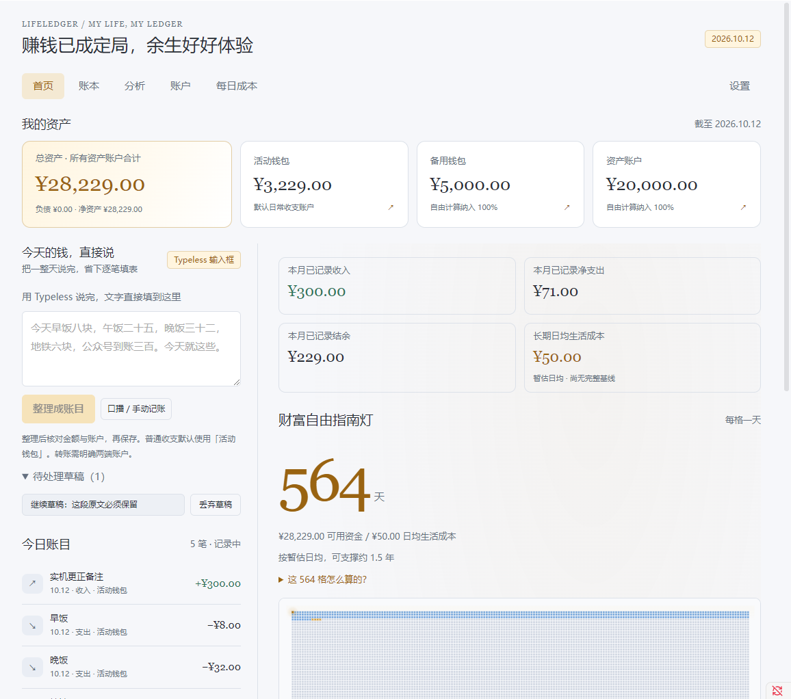
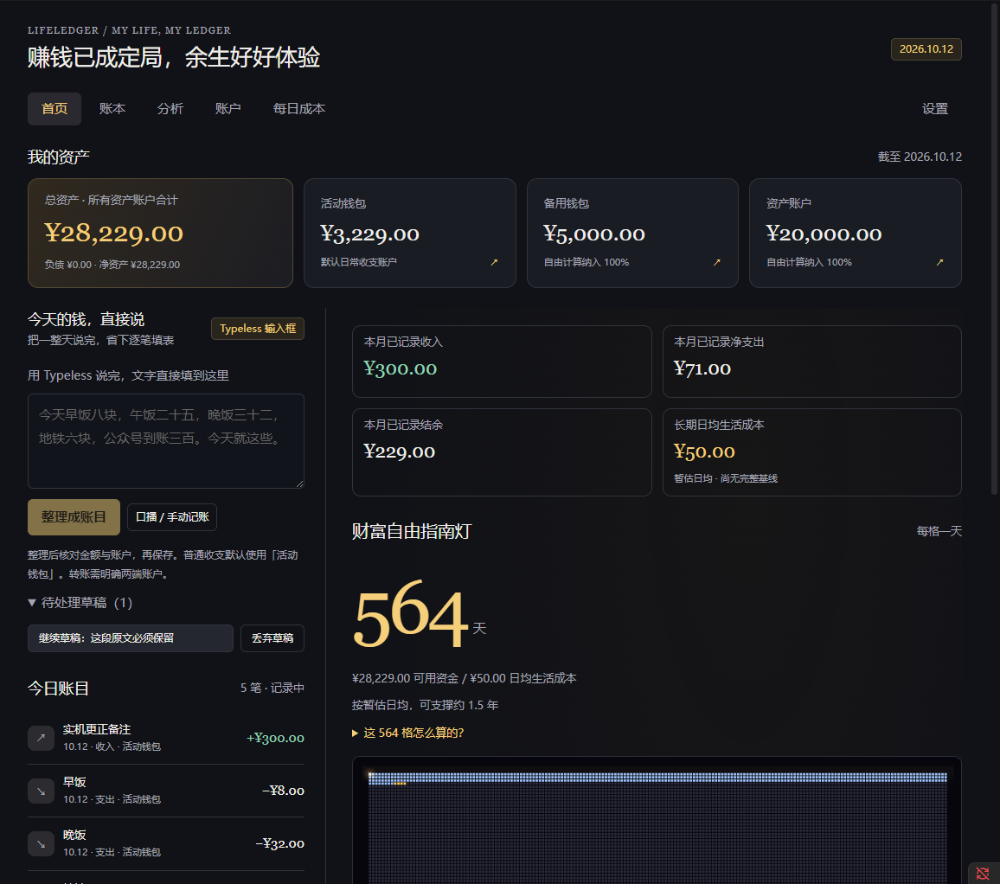
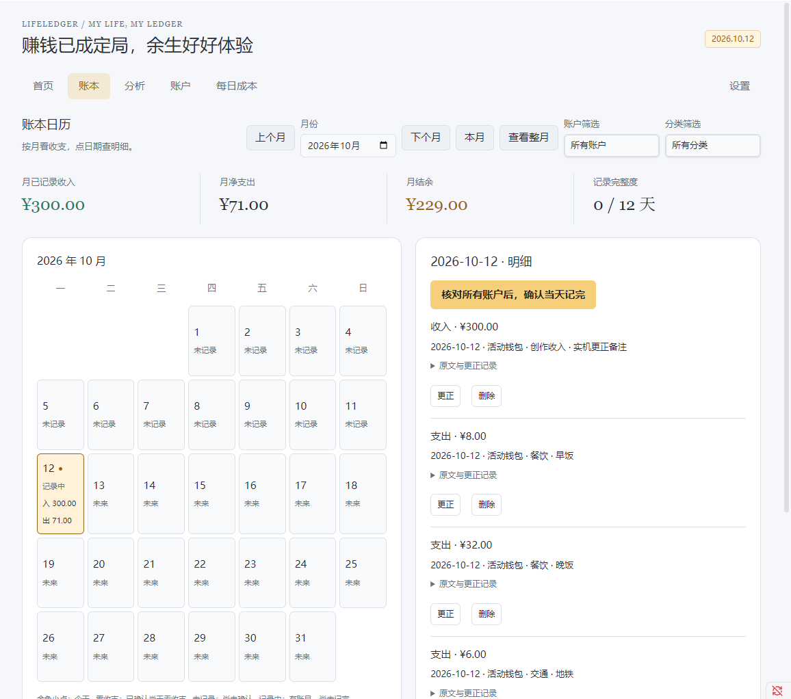
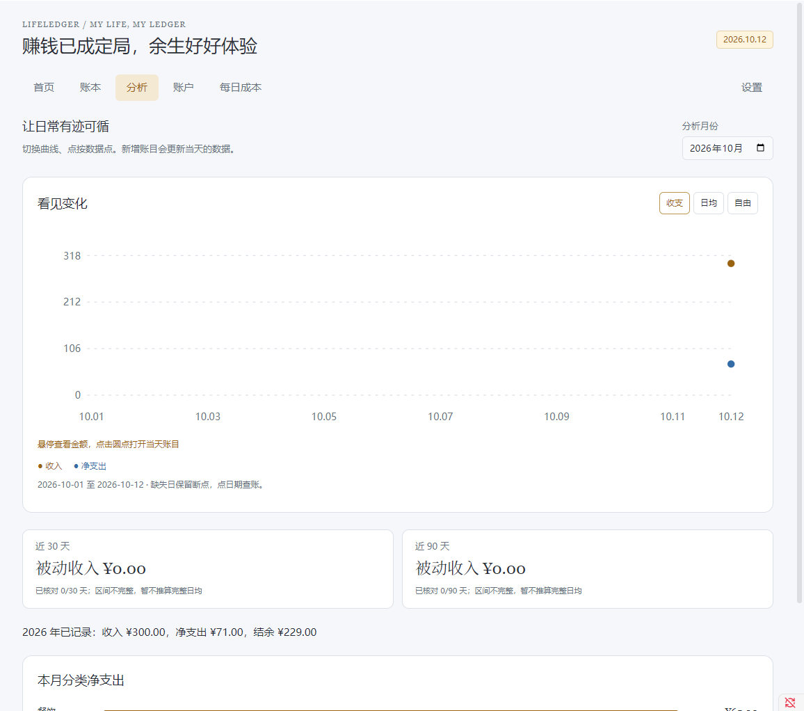
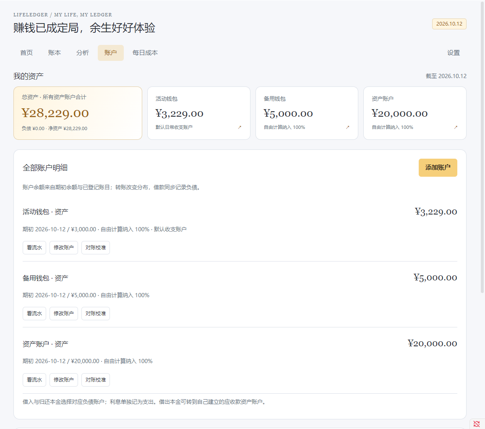
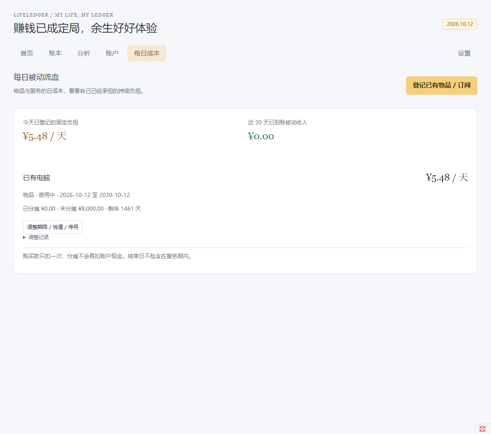

# LifeLedger

**在 Obsidian 里记账，看看现有积累能换来多少自由时间。**

LifeLedger 是一个电脑端 Obsidian 插件，把日常收支、多账户余额、日历账本、每日成本和人生亮格放在一起。手动记账可离线使用；也可以把 Typeless 或键盘输入的整段文字交给自己的 API，核对草稿后集中保存。

当前版本 **0.1.4 开发预览版**，最低 Obsidian **1.11.4**。隔离桌面验证使用 Obsidian 1.14.4。支持深色和浅色外观，自动跟随 Obsidian 的基础颜色。



<details>
<summary>查看深色首页</summary>



</details>

## 想解决什么

一笔消费改变余额，也改变生活成本。只看收入和支出，有时很难感受到积累的意义。LifeLedger 把可用资金除以长期日均生活成本，显示按当前基线可支撑的天数；每一格代表一天，保存后随真实变化点亮或熄灭。

首页保留“赚钱已成定局，余生好好体验”的表达。具体天数由账本和当前设置计算，不预测未来收入或投资收益。记录完整度也参与计算，漏记的日子不会自动变成零消费。详细理念及口径见 [计算与存储](docs/architecture.md)。

## 已有功能

| 页面／能力 | 用法 |
| --- | --- |
| 首页 | 文字录入、今日流水、收支摘要、长期日均、指南灯与趋势 |
| 账本 | 按月／日查账，账户／分类筛选，更正、删除、确认当天记完 |
| 分析 | 收支、日均和自由天数曲线，分类与年度汇总，点按查账 |
| 账户 | 多账户余额、默认收支账户、纳入比例、对账校准、基础借还本金 |
| 每日成本 | 电子产品／订阅分摊，关联购买或登记已有物品，调整期限及停用 |
| 草稿和恢复 | 原文自动保存、API 草稿、逐笔核对、部分保存、整批撤销、JSON 备份恢复 |
| 明暗外观 | 五页、弹窗、日历、SVG 图表、Canvas 人生格及庆祝横幅自动切换 |

插件不内置录音，也不要求启动 Python 后端。没有 API 仍可手动记账。首次安装为空账本；本文截图和开发检查全部使用虚拟数据。

## 安装与更新

1. 打开 [GitHub Releases](https://github.com/wangkefan0309-ui/LifeLedger/releases)，下载 `LifeLedger-0.1.4.zip`。源码页面的“Download ZIP”下载的是工程，不是可直接安装的插件。
2. 解压后，将里面的 `lifeledger-next` 文件夹放到自己的 Vault 的 `.obsidian/plugins/` 中。
3. 确认该文件夹内直接包含 `main.js`、`manifest.json` 和 `styles.css`。
4. 在 Obsidian“设置 → 第三方插件 → 已安装插件”启用 LifeLedger，再点击侧栏钱包图标。

更新时，先关闭 LifeLedger，只覆盖上述三个运行文件，保留 `data.json` 和 Vault 内的账本，再重新启用。可以先导出备份。版本号在 LifeLedger 设置中查看。

当前从 GitHub 手动安装，没有宣称已经进入 Obsidian 社区插件目录。

## 五分钟开始记账

**先建账户。** 填名称、当前余额和余额生效日，明确选择默认日常收支账户。微信、支付宝只用来花日常开销、希望储蓄或投资资金进入指南灯时，可把微信／支付宝的“自由计算纳入比例”设为 **0%**，希望全部计入的资产账户设为 **100%**。

**再记一笔。** 点击“口播 / 手动记账 → 手动加一笔”，填写金额和账户，核对后保存。在账本中确认余额、日期和分类。

**需要 AI 时再配置。** 在 LifeLedger 设置填写自己的 API 地址、模型和密钥，先保存密钥，再保存连接配置并检查连接。默认地址为 `https://api.deepseek.com`，模型为 `deepseek-flash`；其他服务需支持兼容的 Chat Completions 和 JSON 对象输出。真实模型效果需自行核对。

**整段输入，核对保存。** 用 Typeless 将口播变成文字，或直接打字／粘贴到首页。点击“整理成账目”，检查金额、日期、账户和转账方向。AI 只产生草稿，全部计算和保存由插件完成。模糊金额、缺失账户和用途不明的转钱会待补，未完成行可以留在草稿中。

**一天结束后确认记完。** 核对所有账户，确认该日完整；没有流水时也能明确确认零收支。尚无真实完整日均时，可在设置填暂估日均，界面会标记暂估。

完整操作、转账、更正、订阅和备份见 [使用指南](docs/guide.md)。

## 指南灯怎么算

`可用资金 = 各资产账户余额 × 各自纳入比例 − 负债 − 单独预留资金`

`自由天数 = 向下取整（max(0, 可用资金) ÷ 长期日均生活成本）`

比例只影响用于指南灯的资产余额，账户余额和收支仍按实际金额显示。0% 的日常账户发生消费，仍参与生活成本基线。负债全额扣除；已通过比例排除的资金不要再填入单独预留。资金从 100% 账户转到 0% 账户时，可用范围缩小，内部转账本身不计支出。

真实购买款只扣一次；电子产品和订阅的每日分摊另外展示，不每天重复扣现金。金额以整数分计算。详情见 [计算与存储](docs/architecture.md)。

## 数据在哪里，什么时候联网

默认写入自己的 Vault：

```text
LifeLedger/
  配置.md
  账本/YYYY-MM/<批次ID>.md
  草稿/<草稿ID>.md
```

Markdown 中的 `lifeledger-json` 块是计算依据，块外可保留笔记。更正、删除及撤销通过追加事件保留旧版本；发现损坏批次会提示并暂停新账保存。JSON 备份包含配置、批次和草稿，恢复目标须为空目录。

密钥保存在 Obsidian SecretStorage，不写进账本或 JSON 备份。点击 AI 整理会将原文、账户／分类上下文及必要的退款关联发送给用户指定的 API；检查连接只请求模型列表。插件没有另设遥测服务器，手动记账无需 API。具体发送字段见 [AI 拆账协议](docs/ai-protocol.md)。

输入账本目录文字不会立即创建文件，确认切换及首次实际保存才写入。切换目录不搬动原账本。更新插件只覆盖运行文件。

## 当前验证与边界

核心计算与存储 **37/37**、明暗界面与生命周期 **35/35** 检查通过；最终对抗检查和发布包结果见 [验证状态](docs/validation.md)。实机检查使用独立 Obsidian Vault、虚拟数据和本机模拟 API。

真实 API 的重复准确率、Typeless、真实中文输入法、音效人工听验及长期日常记账仍需实际验收。当前为预发布试用阶段。设置中的保存或恢复请等完成后再关窗；快速关闭宿主窗口的异常记录见 [验证状态](docs/validation.md)。

自由天数趋势按当前配置回算；历史配置快照、周／月聚合折线、跨会话逐笔回放、历史账单导入向导、自动投资行情、跨币种和完整分期管理尚未提供。预算、收益预测、手机录入、自动保存 AI 结果和内置录音未加入。

## 更多截图

<details>
<summary>浅色账本、分析、账户和每日成本</summary>






</details>

## 材料导航

- [使用指南](docs/guide.md)：首次设置、账户比例、输入、查账、成本和恢复。
- [理念、计算与存储](docs/architecture.md)：自由天数、完整度、转账、退款、追加账本与模块结构。
- [AI 拆账协议](docs/ai-protocol.md)：原文证据、模糊信息、方向、核对与联网字段。
- [验证状态](docs/validation.md)：已完成检查和真实使用缺口。
- [开发与发布](docs/development.md)：环境、构建、打包、隔离实机和 CI。
- [变更记录](CHANGELOG.md)、[参与开发](CONTRIBUTING.md)、[来源与依赖许可](THIRD_PARTY_NOTICES.md)。

## 从源码构建

需要 Node.js 22+；普通安装用户无需 Node.js。

```powershell
npm ci
npm run verify
npm run package
```

输出在 `dist/`。界面及读写改动还须运行对应隔离 Obsidian 检查，详见 [开发说明](docs/development.md)。GitHub CI 检查核心、构建和打包，不能替代桌面和真实 API 验收。

## 许可

本项目采用 [MIT 许可证](LICENSE)。人生亮格引擎由项目维护者提供的本地代码适配；来源、维护者确认和开发依赖许可见 [说明](THIRD_PARTY_NOTICES.md)。欢迎提交问题或改进；复现材料请使用虚拟数据。
