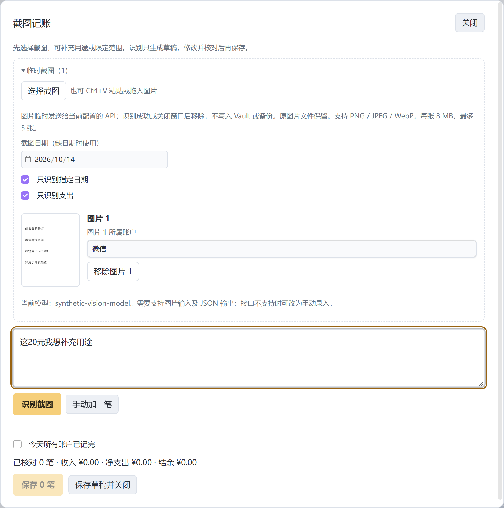

# 使用指南

## 第一次打开

安装并启用后，点击 Obsidian 侧栏的钱包图标。插件从空账本开始，首次保存前不创建账本目录。先添加账户，填写当前实际余额和余额生效日，再选择默认日常收支账户。

“期初余额”是从该日期开始推导余额的起点。之后记录的收支和转账更新余额；早于余额生效日的历史流水可参与分析，但不再次扣今天的余额。已有流水后，期初金额和日期保持固定，余额有差异时使用账户里的“对账校准”，填写实际余额和原因。

## 把常用钱包放前面

0.1.7 起，在首页或账户页的“我的资产”右侧点“账户排序”，对账户使用“置顶”“上移”“下移”，最后点“保存顺序”。首页的资产卡和账户页使用同一个顺序，重开插件及导出、恢复备份后仍保留。

点“关闭”或按 Esc 放弃本次调整。修改账户名称或其他设置会保留它的位置；新增账户排在末尾，可再调整。排序窗口打开时若其他窗口改变配置，本次保存会提示冲突，关闭并重开排序窗口后再调整。

## 按用途组织账户

“自由计算纳入比例（%）”决定账户余额中有多少用于计算指南灯的自由天数。

| 账户示例 | 比例示例 | 效果 |
| --- | --- | --- |
| 微信、支付宝等日常开销账户 | 0% | 保留完整余额及流水，余额不进入指南灯资金 |
| 希望全部计入的储蓄账户 | 100% | 全部余额进入指南灯资金 |
| 只愿意计入一部分的资产账户 | 50% | 一半余额进入指南灯资金 |

比例仅影响资产账户的可用资金，收入和支出按实际金额统计。日常消费仍参与生活成本基线；负债全额扣除。投资账户可按币种分别建资产账户，余额变动通过对账校准记录。支持人民币、美元、港币的参考折算，当前没有证券行情或证券自动估值。

当资金从 100% 纳入的账户转入 0% 纳入的账户，指南灯的可用资金会下降；内部转账仍不计收入或支出。已通过账户比例排除的资金，不要再填写到“单独预留资金”中。

## 手动记一笔

1. 在首页点击“口播 / 手动记账”，选择“手动加一笔”。
2. 填写类型、日期、金额、账户、分类和备注。
3. 对照实际情况检查，勾选已核对，再保存。
4. 在首页或账本查看新流水和账户余额。

手动记账无需 API。保存前的内容是草稿。金额或账户不齐的行不能入账；可先保存其他已核对的行，剩下的继续留在草稿里。部分保存不表示当天所有收支已经记完。

## Typeless 和 AI 整理

Typeless 是外部文字输入工具，插件不内置录音。将一整天或一段消费说完，让文字落在首页输入框，再点击“整理成账目”。也可以直接键入或粘贴文字。

首次使用 API，在 Obsidian 设置中找到 LifeLedger，填写 API 地址、模型和密钥，先点击“保存密钥”，再点击“保存连接配置”，然后检查连接。当前默认地址为 `https://api.deepseek.com`，模型为 `deepseek-flash`。使用其他兼容接口时，需要它支持 Chat Completions 和 JSON 对象输出；连接检查通过仍需用自己的样例核对实际拆账效果。

示例原文使用虚拟金额：

> 今天微信早饭八块，午饭二十五块，地铁六块。银行卡到账三百。从储蓄账户转五百到支付宝。不对，是五十。

核对框显示原文及每笔草稿。检查金额、日期、账户、转账两端和所有疑问，必要时直接修正。AI 不写余额、不保存交易，也不会用默认账户补齐转账两端。“几十块”、未知账户或用途不明的转钱，需要补齐事实后保存。

API 失败、超时或返回不完整时保留原文及草稿；已有账目不因请求失败改变。待处理草稿可以重开，或按 Obsidian 的删除偏好丢弃。

## 用账单截图记账

1. 首页点击“截图记账”，选择文件、Ctrl+V 粘贴图片，或将截图拖进录入窗口。支持 PNG、JPEG、WebP，每张不超过 8 MB，一次最多 5 张，总计不超过 20 MB。
2. 每张选择实际所属账户；不确定可留空，识别后再补。微信／支付宝的页面标题不一定等于付款账户。选择截图日期，默认只识别该日的支出；需要收入、退款和转账时取消“只识别支出”。
3. 补充说明可留空，也可写“这笔20元是打车”“只记实际支付”。点击“识别截图”才向你配置的 API 发送图片。
4. 检查草稿，修改备注、分类、金额、账户或日期，勾选核对后保存。例如图片仅写“零钱支出20”，在备注补“打车”、分类选交通即可，无需重新识别。

余额、月汇总、未完成订单和范围外记录会列为排除项。充值及退款用途不清时待补；多张重叠截图会提示疑似重复，请移除重复行，真实重复消费可以保留。金额或账户不齐不能保存，截图不自动证明今天所有账户记完。

选择图片不会写入账本。成功识别或关闭窗口后，临时图片移除；失败时当前窗口保留以便重试。原文件不删除。草稿和备份只保留识别文字、补充说明及更正，重开能继续改；再次识别需要重新选图。服务端请求日志留存取决于供应商。

沿用现有服务地址、模型和密钥，模型需支持兼容 Chat Completions 图片输入及 JSON 输出。[DeepSeek 官方 Vision 文档](https://api-docs.deepseek.com/guides/vision/)当前说明 Flash 支持图片。连接检查仅查模型列表；实际识别效果需用自己的截图核对。图片不上传到图床，也不通过 Files API 保存。

## 每天确认记完

在账本选择日期，核对所有账户的收支，确认当天已记完。没有流水的日期也可以明确确认零收支。未确认的日期不会被当成零消费；已确认后补记普通收支，会回到待核对。

首页长期日均采用从观察起点开始的连续完整日期。还没有真实基线时，可在设置填暂估日均，界面会标记暂估。如果中间漏记，先补齐并确认该日，再向后延长完整基线。

## 查账、修改和撤销

账本按月份和日期显示流水，可筛选账户和分类。图表上的点支持查看金额和跳转到对应日期；账户卡可以进入该账户的明细和流水。

已保存的流水可以更正或删除，并保留旧版本。首页的“撤销最近一批”同时撤销该批次的交易及关联成本，通过新增反向事件保留原记录。插件重开后仍能撤销最近一批，但不会自动重播动画；“回看刚才的变化”只保留当前会话的变化。

## 电子产品和订阅的每日成本

购买时，可在消费草稿中建立关联成本项目。现金购买款只记一次；日均分摊用于理解成本，不每天再次扣余额。没有明确使用期限时，期限留待补齐。

已经购买的电脑、设备或订阅，进入“每日成本”，点击“登记已有物品 / 订阅”。填写名称、实付金额、开始日、结束日和预计残值。这条登记不新增消费流水。结束日不包含在服务期内；可修改期限或提前停用。同名订阅服务期重叠时会提示。

订阅到期后，实际续费再记一笔新的购买及服务期；插件不会自动付款。每日成本摘要与长期生活成本基线分别展示，成本分摊不作为第二笔现金支出。

## 首页标语、外观与音效

在“设置 → LifeLedger → 首页与外观”填写喜欢的标语或格言，最多 120 字，留空使用“把账记清楚，把日子过明白”。“页面外观”可选浅色、深色和跟随系统，点击“保存首页与外观”后生效；关闭设置会放弃未保存的修改。

固定浅色或深色只影响插件页面及记账弹窗，不改变 Obsidian 的外观。“跟随系统”按电脑的深浅模式自动切换，与 Obsidian 单独设置的基础颜色无关。五页、弹窗、图表和人生格使用同一套布局与交互，系统切换不会打断输入。标语和外观随账本配置保存，重启、导出及恢复备份后保留，不改变账户余额、流水或生活成本计算。

每一格代表一天。蓝色表示期初可用资金支持的天数，金色表示后续增加的部分。保存和撤销后按真实变化播放点亮或熄灭；可以跳过、静音，或在设置改为短动画／关闭动画。操作系统启用减少动态效果时，完整追焦会跳过。

## 移动或改名账本文件夹

默认 `LifeLedger/` 是 Vault 内的账本数据目录，可以在同一个 Vault 内整体移动、改名，例如 `财务/我的账本`。

1. 保存待处理草稿，关闭录入窗口，在设置中导出完整 JSON 备份；等待保存与备份操作完成。
2. 关闭 LifeLedger 插件，将整个 `LifeLedger` 文件夹移动、改名，保留里面的 `配置.md`、`账本`、`草稿` 及全部内容。
3. 重新启用插件，进入“设置 → LifeLedger → 文件存储 → 账本目录”，填入相对于 Vault 的新路径，例如 `财务/我的账本`，点击“打开此目录”。
4. 确认账户、余额和历史账目已出现，再继续记账。

当前插件不会自动跟随文件夹移动或改名；仅改设置路径也不会搬迁文件。路径指向空目录时会显示空账本，需要重新选择已有数据的新位置。新路径必须在当前 Vault 内，不能使用磁盘绝对路径或 Obsidian 配置目录。外层目录名称可改，内部固定文件与子目录名称保持。

`.obsidian/plugins/lifeledger-next/` 是插件安装目录，名称仍为 `lifeledger-next`；移动账本时保持该安装目录原位。源码目录的移动另见 [开发说明](development.md)。本节为按现有实现核对的操作说明，本次没有移动用户账本。

## 备份与恢复

设置中可导出完整 JSON 备份，包含配置、批次和草稿，不包含 API 密钥。也可以关闭插件后备份整个账本文件夹。

JSON 恢复须使用完全空的目标目录，不能包含账户、配置、草稿、旧批次或其他笔记。已有数据时，先在设置中切换到新目录，再选择 JSON 备份。切换目录不会搬动旧账本；输入目录文字不会立即创建文件，确认切换及首次实际保存才会写入。

如果提示正式配置或批次损坏，先保留原文件，恢复有效备份，再重新读取；不要手工改动 `lifeledger-json` 内的金额或校验和。损坏草稿会单独提示，完整备份前需处理。

在设置中保存或恢复后，请等操作完成再关闭设置窗口。恢复中立即关闭窗口的空栈异常单独登记在 [验证状态](validation.md)，数据完成与窗口异常分别判断。

## 港卡、美元账户与实际换汇

添加账户时选择本币 CNY、USD 或 HKD，并按本币填写余额。可勾选“显示其他币种的折算余额”及默认折算币种；外币主余额保持原数，卡片小“⇄”按钮只切换另一币种的约合显示。同一家银行持有多币种时，分别建“汇丰港币”“汇丰美元”等账户。有过历史流水后，本币固定。

账户区“⇄ 换汇”打开换算框，输入金额即可计算。参考汇率可更新或手动填写 1 美元／港币折合多少人民币。开启外币账户后，打开插件每天按获取日期更新一次；最近发布日可能早于今天，来源和日期均显示。断网保留缓存，历史交易不会被新报价重算。参考来源为 [Frankfurter / ECB](https://frankfurter.dev/)，[ECB 参考汇率](https://www.ecb.europa.eu/stats/policy_and_exchange_rates/euro_reference_exchange_rates/html/index.en.html)用于信息展示。

真实换汇时勾选“同时记录一笔已发生的账户换汇”，选择不同账户，填换汇本金的实际扣款和实际到账，确认后保存。参考结果不会代替实际到账；本金不计收入支出，单独扣收的银行手续费另记支出。如果银行总扣款包含手续费，先拆分本金和手续费再录入，两笔合计应等于银行总扣款。更正和撤销同步两端，备份包含币种和汇率快照。

外币消费或收入保留本币，人民币收支和成本使用核对后保存的汇率快照。补历史流水时请核对当时汇率。每日成本展示人民币折算，不重复扣原币现金；当前借还本金及应收款转移须同币种。

## 食堂饭卡口播

建立“食堂饭卡”账户，在别名中填“学校食堂，食堂，饭卡”，并按需要把自由计算纳入比例设为 0%。

- “学校食堂吃饭减15”：按饭卡账户支出 15 元，仍需核对再保存。
- “从微信往食堂饭卡充50”：微信减50、饭卡加50，同一条内部转账，不重复计消费。
- “往食堂饭卡充50”：转入已明确，转出待补，不能直接套默认钱包。
- “用微信在学校食堂吃饭15”：按明确付款账户微信，地点不会覆盖付款账户。

多个账户用途不清或模型缺少该笔账户证据时留待补齐。规则能检查已配置的名称和唯一别名，真实模型及 Typeless 的识别准确率仍需实际验收。
